# Face bench

Six fixed heads that judge whether the agent builds a face from volumes
([ADR-0013](../adr/0013-volumetric-head-construction.md)). Each brief is drawn
twice — 48 px and 96 px head height — before and after a change to the head
rules or to `draw` op `headArmature`, and the results are laid side by side.
The verdict is a person looking at the sheet, not the `validate` score.

| # | Archetype | View | `headArmature` | Brief |
|---|---|---|---|---|
| 1 | `realistic` | 3/4 | `yaw: -25` | A grey-haired ship captain, square jaw, heavy brow, short beard line, lit from the upper left. |
| 2 | `realistic` | 3/4, seen from below | `yaw: -25, pitch: 20` | The same captain looking up at a mast: the jaw underside shows, the feature lines bow upward. |
| 3 | `adventure` | 3/4 | `yaw: -25` | Remake of MON-574: a young adventurer with a ponytail and a scar over the left brow, bust portrait. |
| 4 | `adventure` | front | `yaw: 0` | The same adventurer, front, neutral expression, for a dialogue box. |
| 5 | `anime` | 3/4 | `yaw: -25` | A cheerful mage girl with long bangs and large decal eyes, slight smile. |
| 6 | `anime` | front | `yaw: 0` | The same mage, front, surprised (brows up, eyes wide, O mouth). |

`chibi` is out of the bench: its construction is a decal on a ball, not a
planar head.

## Running it

1. Canvas: 64×64 for the 48 px head, 128×128 for the 96 px head, RGB, a skin
   ramp of 5, hair ramp of 4, cloth ramp of 3, transparent backdrop.
2. Give the brief as written, plus "bust portrait, head N px tall", to a fresh
   session with no other instruction (`docs/evals/benchmarks.md`, procedure
   1–3). Do not mention the armature: whether the agent reaches for it is part
   of what is measured.
3. Capture `look op="preview"` of the result and the guide layer, if any.
4. Lay the twelve heads out in brief order, before above after, at 4×.

## What passes

Per head, all of:

- The block-in alone (planes or the first flat pass) reads as a head turned
  the way the brief says, at 1×.
- The cranium is one ovoid: in 3/4 the back of the skull shows behind the ear.
- A visible front/side break; the eyes sit in sockets under the brow; in 3/4
  the far eye is narrower.
- Brief 2: the underside of the jaw is its own plane and the eye line bows up.
- Hair sits on the cranium, stops at the ears; the neck goes under the skull.
- The same character reads across its two briefs (1–2, 3–4, 5–6).

## Results

### 2026-10-29 — `gpt-6.1-terra`, Hermes, headless Aseprite

Rows: npm 0.8.2 (before) · the branch with faceted planes (after v1) · the
branch with `values: "masses"` (after v2). One run per cell, no retries.

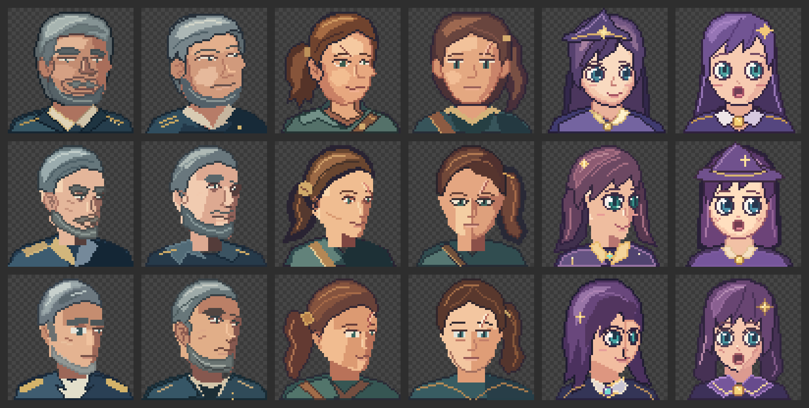
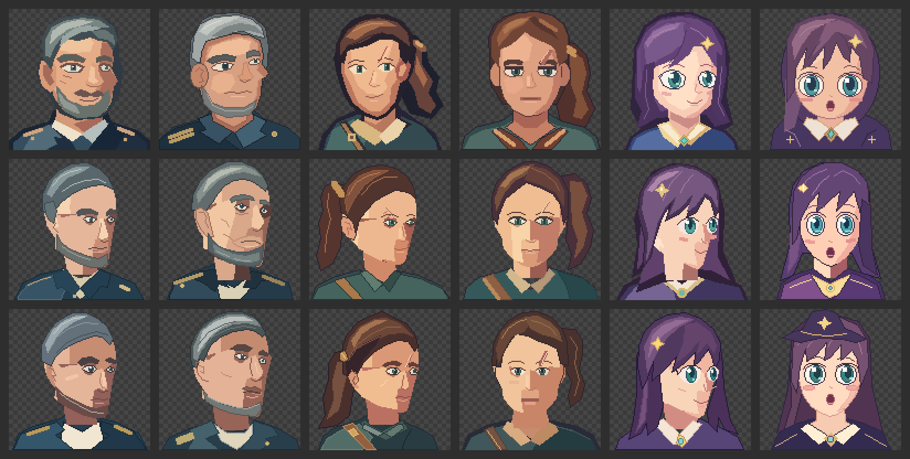

- The armature was used in all 24 branch runs, with no mention of it in the
  brief. Before the rule became a gate in `draw` step 1b, the agent read the
  rules and still blocked the head in by hand.
- Construction improves. The 3/4 heads turn instead of sliding, the cranium
  shows behind the ear, and the underside of the jaw shows from below (brief
  2). The far eye is narrower.
- Finish regresses. v1 left the plane facets in the skin, and the result
  reads as a mask. v2 removes most of them but keeps a hard half-tone seam
  down the face. The before row is still the more appealing set.
- `anime` should not carry modelled planes: brief 5 v2 has a block of shadow
  on the lower face where cel shading wants one flat value.

Verdict: **not passed**. ADR-0013 stays *proposed*. Next steps: two values
for `anime`/`chibi`, a softer half-tone edge for `realistic`/`adventure`,
then run the bench again.

### 2026-10-29, second pass — wrapped light, cel masses, smoothed terminator

Rows: npm 0.8.2 · v3 (wrapped light, two cel values for `anime`/`chibi`) ·
v4 (per-pixel smoothed masses for `realistic`/`adventure`). Brief 4 at 48 px
timed out once (agent stalled, 30 min) and was run again.

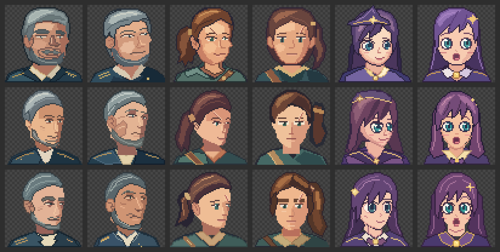
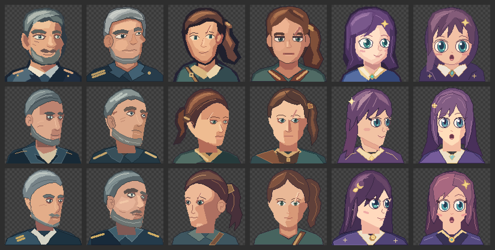

- The facets and the seam down the face are gone; the anime faces are flat
  again, and the front views (briefs 4 and 6) now hold up against the before row.
- 3/4 and low angles keep the gain in construction, at both sizes.
- The remaining gap is character, not volume: the hair fills the armature's
  hair shell exactly and reads as a swim cap, and the captain's beard became
  a thin band along the jaw. The before row wins on hair and beard.

Verdict: **not passed yet**, closer. Next: the hair shell becomes the inner
limit of the hair, never its outline (rules 32/38, `pixel-critic` 9d).

### 2026-10-29, third pass — hair breaks the shell

Rows: npm 0.8.2 · v4 · v5 (hair shell as inner limit, beard on the jaw planes,
`pixel-critic` 9d).

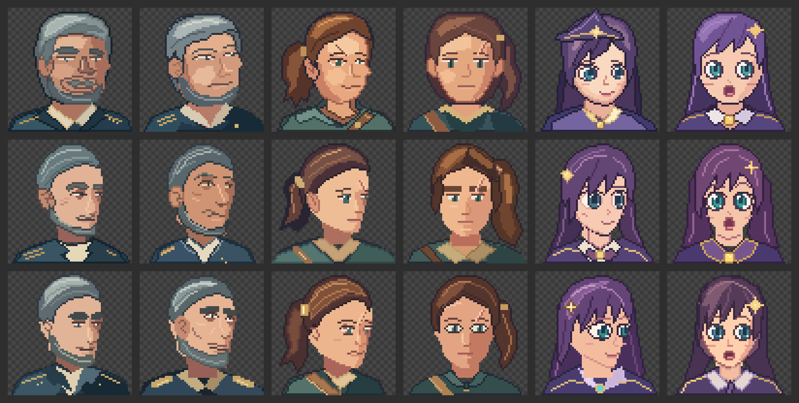
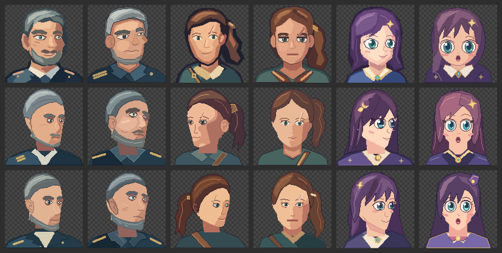

- Hair improves: the ponytails get volume and locks over the hairline, the
  anime hair falls past the shell; no more swim caps.
- The captain is still the weak cell. His head comes out a narrow egg
  (width/height 0.62 on a front realistic head) where the brief asks for a
  square jaw; the beard follows that narrow jaw.

Next: a wider cranium and face (front realistic head ≈ 0.7 wide for 1 tall,
eyes one eye-width apart), then run the bench again.

### 2026-10-29, fourth pass — wider heads

Rows: npm 0.8.2 · v5 · v6 (wider cranium and face, eyes further apart).

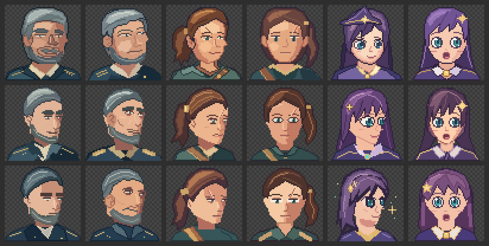
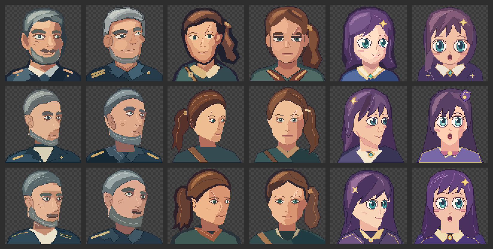

- The captain gets his width back: square jaw, the beard is a mass on the jaw
  and chin, the heavy brow reads. The front views hold against the before row.
- The 3/4 heads look over-turned. Measured on the armature: at yaw −35 the
  nose sits 0.17 of the head width from the far contour, a strong turn, not a
  portrait 3/4 (about 0.25, reached at yaw −25). The rules said ±30–40°, so the
  agent always picked −35.
- The heavy shadow on the anime 3/4 at 48 px is the agent's paint, not the
  armature: every anime plane except the neck is on the light step.

Next: a portrait 3/4 is yaw ±20–25° (rules 32/38, `draw`, `concept`,
templates, bench table), then run the bench again.

### 2026-10-29, fifth pass — portrait three-quarter at yaw −25

Rows: npm 0.8.2 · v6 · v7 (3/4 = yaw ±20–25°).

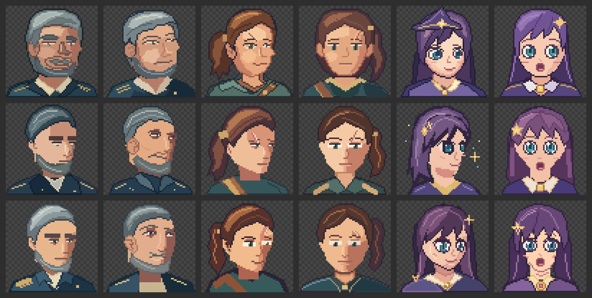
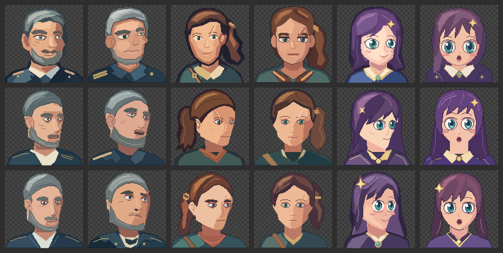

- The 3/4 heads read as portrait three-quarters: a sliver of far cheek beyond
  the nose, the far eye narrower but whole. The captain in 3/4 now beats the
  before row (square jaw, heavy brow, beard on the jaw).
- The anime pair holds level with the before row.
- What still loses at 48 px: the adventurer's eyes. The armature opened the
  lid to 5×4 px with the brow on the row right above, and the agent painted a
  heavy, half-closed eye on both briefs 3 and 4.

Next: below 72 px the lid opens up to 1.4× (48 px → about 7×5) and the brow
keeps one skin row above the lid, then run the bench again.

### 2026-10-29, sixth pass — readable small eyes

Rows: npm 0.8.2 · v7 · v8 (48 px lid opening up to 1.4×, brow one row higher).

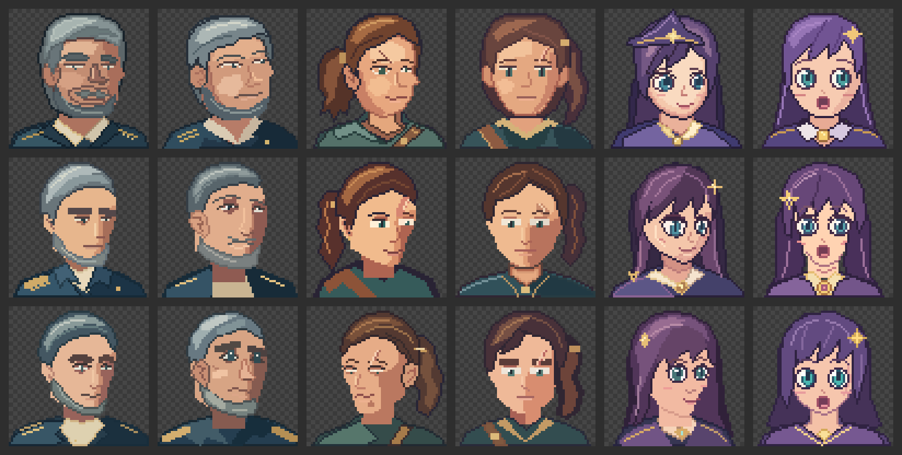
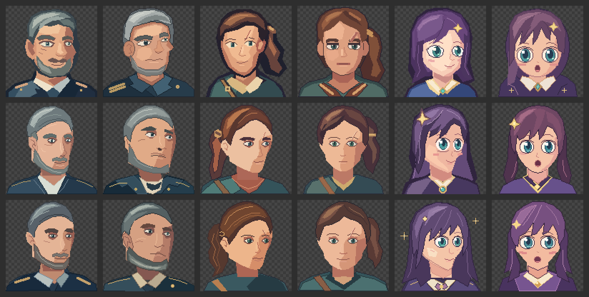

- At 96 px the branch now holds or beats the before row on the captain (both
  angles) and the adventurer (both angles): turned heads, square jaw, jaw
  underside from below, open eyes.
- At 48 px the eyes are bigger but the agent still paints the upper lid as a
  dark band: the rules told it the orbit is the darkest skin value, which at
  48 px fills the whole space between brow and lid. The before row keeps the
  more open, appealing eyes.
- Anime 3/4 (both sizes): the agent paints a hard shadow wedge across the
  cheek, although the armature hands it a flat face.

Verdict: **not passed yet** — 96 px is there, 48 px and anime finish are not.
Next: below 64 px the orbit is one mid-shadow row and the darkest dark goes to
the lid line and pupil only; anime faces stay cel-flat with cast shadows only
(rules 32/33/38, `pixel-critic` 9e).
